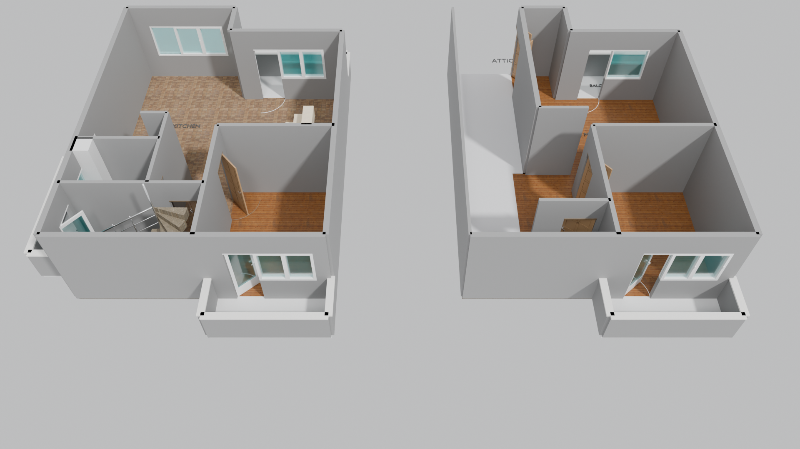
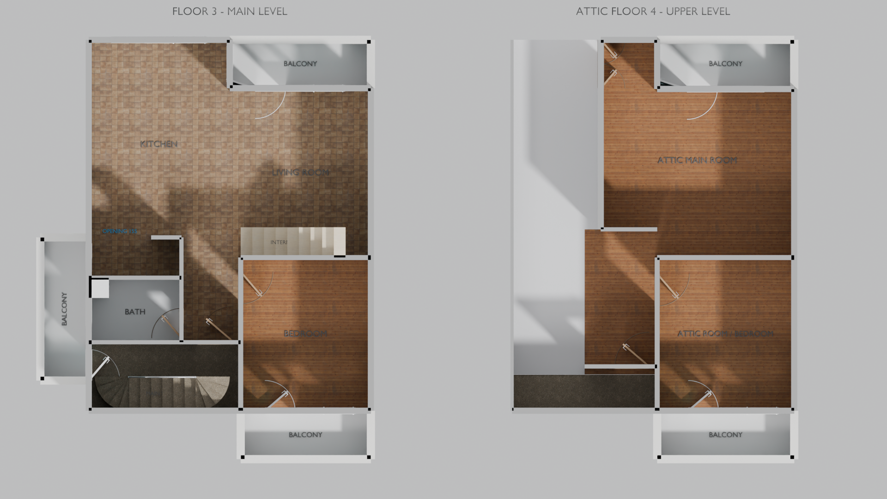

# Markovo 3D Architectural CAD / BIM

A parametric 3D architectural CAD generator and Cycles raytracer for a multi-level residential building (Floor 3 Main Level and Floor 4 Attic Level) in Markovo, built with Blender's Python API (`bpy` / `bmesh`).

---

## Visual Showcase

### 3D Perspective Overview


### Orthographic Top-Down CAD View


---

## Features

- **Semantic Room & Floor Referencing**:
  - Every architectural component (walls, windows, doors, stairs, balconies) is indexed strictly by **Room Name** and **Floor Level** (e.g. `room="Kitchen"`, `id="kitchen_window"`) for clean, unambiguous programmatic manipulation.
- **Parametric Openings**:
  - Walls automatically slice lintels, sills, and door openings at build time without brittle CSG Boolean modifiers.
- **Architectural Material Palette**:
  - **Kitchen & Living Room**: Mediterranean baked clay terracotta tiles.
  - **Bedroom & Attic Rooms**: Scandinavian parallel light coniferous wood parquet.
  - **Main Stairs & Landings**: Architectural concrete with double-curved winders (bottom and top) and round satin aluminum railing.
  - **Internal Stairs**: White maple veneer stringers and treads.
  - **Windows & Exterior Doors**: Clean white uPVC profiles with architectural double glazing.
  - **Terraces**: Solid masonry parapet walls matching building facade, topped with stone coping with overhang (no glass).
- **Dual Visual Modes**:
  - Side-by-side 2-panel layout for CAD orthographic review (`--render`).
  - Vertically stacked multi-story 3D assembly (`--stack --render`).
- **Production Studio Lighting**:
  - Studio sun light, soft architectural fill light, and calibrated Cycles camera rig for instant publication-quality rendering.

---

## Quick Start

### 1. Headless Scene Build (< 1.5 s)
Verify that the complete 3D model compiles with zero errors:
```bash
blender -b --python scripts/blender_floor_plans.py
```

### 2. Render High-Resolution PNGs
Renders both Perspective and CAD Top views to `renders/`:
```bash
blender -b --python scripts/blender_floor_plans.py -- --render
```

### 3. Stack Floors Vertically in 3D
Builds Floor 4 directly on top of Floor 3 and renders the stacked perspective:
```bash
blender -b --python scripts/blender_floor_plans.py -- --stack --render
```

### 4. Interactive Blender GUI
1. Launch Blender.
2. Open [`scripts/blender_floor_plans.py`](scripts/blender_floor_plans.py) in the **Text Editor**.
3. Press **Alt+P** (Run Script) to inspect, orbit, and edit the model in 3D.

---

## Repository Structure

```
├── README.md                      # Project overview and render gallery
├── AGENTS.md                      # Quick-reference cheatsheet for AI coding assistants
├── docs/
│   ├── AGENT_INSTRUCTIONS.md      # Comprehensive architecture, geometry & workflow guide
│   └── MATERIALS_GUIDE.md         # PBR shader graphs, procedural node setups & tuning
├── renders/
│   ├── markovo_floor_plans_perspective.png
│   └── markovo_floor_plans_cad_top.png
└── scripts/
    ├── blender_floor_plans.py     # Main CLI entry point and hot-reloader
    └── cad_markovo/
        ├── builder.py             # FloorPlanBuilder core (wall cutouts, room extrusion)
        ├── config.py              # Vertical dimensions, tolerances, units
        ├── floor3.py              # Floor 3 (Main Level) room, wall & opening specification
        ├── floor4.py              # Floor 4 (Attic Level) room, wall & opening specification
        ├── geometry.py            # Low-level 3D primitives, windows, doors, curved stairs
        ├── materials.py           # PBR & procedural architectural material shaders
        └── scene.py               # Studio lighting, cameras & Cycles rendering engine
```
